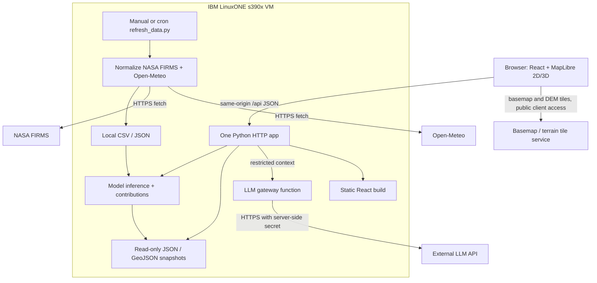

# FireWatch v4 — LinuxONE-first architecture

**Scope:** California only. **Team:** 3 ML (Ridwan, Eshann, Serena), 3 application. **Goal:** hackathon MVP, not an operational emergency-management system.

## Product contract
- **Observed layer:** newest available NASA FIRMS satellite thermal-anomaly detections. These are hotspots, *not confirmed active fire perimeters*; timestamps and source are always visible.
- **Close-up coverage:** *illustrative hotspot-influence zones* made by buffering/merging detections; **not a calculated burned area, not a fire boundary, not a safety radius**. Never report their area as actual land burned. Optionally show `visualized_coverage_km2` with explicit `illustrative_only=true`, never as acres burned.
- **Forecast layer:** model-estimated 7-day chance of **at least one qualifying hotspot in a defined California grid cell**. It does *not* predict exactly where fires will start, spread, or burn. Show observation window, model version, confidence/calibration caveat.
- Search city/town/county/ZIP within California; dynamic location panel; 2D/3D toggle; chatbot only answers from supplied observations, forecast, weather, and trustworthy metadata. The LLM is external, not an on-box LLM.

## Deployment — only one application service



**Runtime:** a single Python process serves `/api/*` plus `frontend/dist/` (where framework permits). No database, Redis, queues, containers, WebSockets, or microservices. Run scheduled/manual refresh as a separate short-lived command, not in web request handlers. Use snapshot files with `os.replace()` for atomic publication. Protect `data/private/` and secrets from static routes. If FastAPI/Pydantic install fails on s390x, expose the **same API** through Flask if available, or a minimal Python stdlib HTTP server (only as hackathon fallback). Host VM and Jupyter ML container are distinct environments; packages in one do not imply packages in the other.

### Suggested repository
```
firewatch/
  frontend/                 # Vite + React, map components, CSS
  backend/
    server.py               # HTTP routes / static build
    services/{fires,forecast,places,chat}.py
    refresh_data.py         # NASA, weather, snapshots
    ml/{features,train,predict,explain}.py
    schemas.py              # documented response shapes
  data/
    public/{fires.geojson,coverage.geojson,risk.geojson,places.json,metadata.json}
    raw/                    # CSV input, exclude large files from git
  models/{risk_model.json,features.json,metrics.json}
  tests/{test_contract.py,test_prediction.py,test_layers.py}
  .env.example
  README.md
```

## Snapshot and update flow
1. Run `python3 backend/refresh_data.py` (after organizer authorization). Get FIRMS observations for California bounding box approximately `-124.5,32.5,-114.0,42.1` (clip to actual CA polygon); NOAA-20/NOAA-21 VIIRS data when available; include source and UTC observation date/time.
2. Get regional weather for the predefined grid, cache the response; use the **forecast** API for future weather and historical/reanalysis API for past training weather. Never train using weather that was unavailable at the prediction cutoff unless documenting the approximation. Avoid leak from a fire observed inside the target seven-day horizon.
3. Inference across fixed grid cells (start county-level or coarse grid if time-constrained). Store forecast probabilities and XGBoost contributions in JSON. Calibration/held-out evaluation strongly preferred; do not call raw scores calibrated probabilities unless validated.
4. Convert fires to point GeoJSON, generate approximate buffer visualization as separate coverage GeoJSON, build forecast cell GeoJSON. Write `*.tmp`, validate, atomically rename. Keep previously valid snapshots if refresh fails.
5. Client GETs snapshots via one backend and renders MapLibre layers; no request to NASA on each zoom/pan.

## Zoom / 3D rendering design
- **Zoom 4–8:** NASA points as cluster circles / glow heatmap. Predicted risk as translucent cells or heatmap. Do not simultaneously encode both using indistinguishable hot colors.
- **Zoom 8–11:** individual observations and semi-transparent approximate hotspot-influence shapes. Avoid pretending to show fire boundaries; opacity edge feathering in styling only.
- **Zoom 11+:** localized illustrative shapes, observations and click details. Optional risk cells drawn as `fill` with outline. Underlying terrain remains visible.
- Toggle *2D ⇄ 3D* by changing **MapLibre camera pitch and terrain** on the **same map instance**; never create a separate 3D rendering pipeline. `raster-dem` tiles + `map.setTerrain` if supported. Keep ordinary point/fill/heatmap layers enabled in both views and QA them at steep pitch. MapLibre documents terrain support; exact heatmap/terrain interaction must be tested on the selected version/style.
- Clip observations and polygon footprints to California in backend for California-only data. Default `maxBounds` is CA bounding box with margins, but overlays are CA-masked; ZIP/city search filtered to CA.
- Geographically accurate basemap requires licensed/attributed basemap tiles; terrain requires a DEM tile source. These are **additional external tile dependencies**. Cache/fallback 2D if provider or graphics fails; avoid using unlicensed third-party servers in production.

## API calls and concurrency
| Operation | Method | When | Mode | Safeguard |
|---|---|---|---|---|
| Browser → `/api/v1/fires` | GET | initial / refresh | asynchronous browser fetch | stale snapshot marker, ETag if practical |
| Browser → `/api/v1/risk` | GET | overlay switch | asynchronous browser fetch | cache results, no per-pan model run |
| Browser → `/api/v1/places?q=` | GET | search typing | async/debounced, cancel older requests | min 2 chars, max 20 results |
| Browser → `/api/v1/locations/{id}` | GET | select | asynchronous browser fetch | cached lookup |
| Browser → `/api/v1/chat` | POST | question | awaited HTTP response, async outbound LLM if supported | timeouts, context whitelist, no secrets |
| Scheduled Python → NASA FIRMS | GET CSV | manual/periodic refresh | sequential OK, batched async optional | MAP_KEY, 1–5 day range, bounded region, retries |
| Scheduled Python → Open-Meteo | GET JSON | manual/periodic refresh | bounded parallel optional | rate limits, retries, precomputed grid |
| Feature extraction + ML inference | Python call | refresh | synchronous/batch | bounded memory, validated schema |
| Rendering + mode switch | MapLibre methods | every interaction | client-only | same source/layers in 2D/3D |

## LinuxONE, s390x, and maintenance checklist
- First collect `uname -m`, `python3 -V`, `python3 -m pip --version`, `python3 -c 'import xgboost,sklearn,pandas,numpy'` **in the actual runtime**. Initial SSH Python may be bare Ubuntu even when a separate Jupyter image includes ML packages. Get organizer permission before modifying allocated machines.
- **Candidate dependencies:** Python 3.12 if already present; pandas, numpy, scikit-learn, XGBoost only after native import + fit/predict test; FastAPI/Pydantic or Flask after installation on s390x; `requests`/stdlib urllib; Node/Vite build frontend on a supported machine then copy static assets if Node absent on LinuxONE. Version-pin **only after testing**.
- **SHAP fallback:** XGBoost native `Booster.predict(DMatrix, pred_contribs=True)` returns tree feature contributions in raw model output units plus bias term. For binary logistic objective they sum to raw margin, not direct probability percentages. The Python `shap` package is optional, not a critical dependency.
- **No native circular buffering requirement:** simple visual influence circles can be rendered in MapLibre as styled point circles. For client-visible rough area polygons if needed, approximate locally via geodesic offset math / GeoJSON; using shapely/GEOS is optional and requires LinuxONE testing.
- Use environment variables for FIRMS map key / LLM key, never commit them or pass LLM keys to browser. Bind public HTTP server only after organizer/network approval; handle CORS by same-origin static serving.
- Include stale timestamps, model version, prediction window and a high-visibility safety disclaimer: *Not for evacuation, dispatch, or emergency decisions; consult official authorities.*

## Why LinuxONE actually matters
Show terminal recording of `uname -m` (s390x), the executable ingestion refresh and XGBoost inference on the same LinuxONE VM, snapshot updates, and a live browser request to LinuxONE `/api/v1/status`. **No unverified claims of speed/security/uptime advantages.** The story: a LinuxONE Linux system hosts the end-to-end pipeline for a public-interest, geo-spatial forecasting workload with minimal operational complexity.

## Reference links
- NASA FIRMS Area API: https://firms.modaps.eosdis.nasa.gov/api/area/
- NOAA-20/21 FIRMS products: https://firms2.modaps.eosdis.nasa.gov/usfs/api/area/
- Open-Meteo historical: https://open-meteo.com/en/docs/historical-weather-api
- Open-Meteo forecast: https://open-meteo.com/en/docs
- MapLibre terrain: https://maplibre.org/maplibre-gl-js/docs/examples/3d-terrain/
- FireMap visual reference: https://www.firemap.live/
