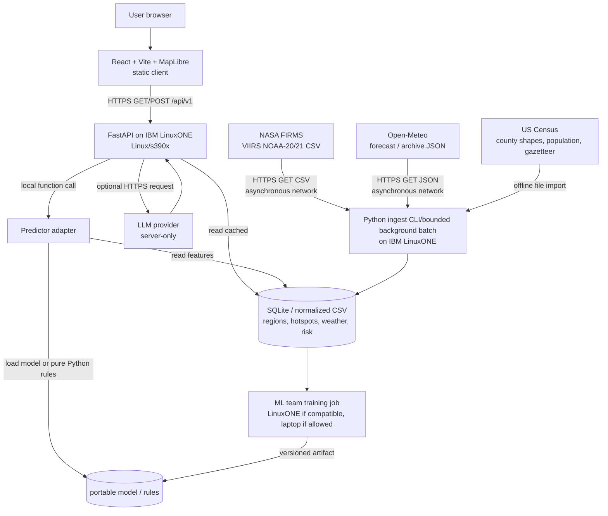
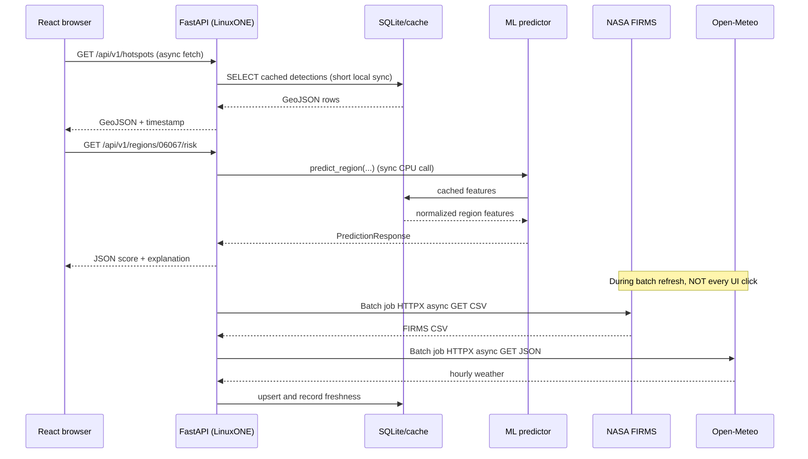

# FireWatch — Architecture, API Flow and Compatibility Gate

## A. End-to-end platform topology



**Separation:** UI → internal FastAPI → cached/normalized data + predictor. Only backend/batch jobs talk to NASA/weather/LLM. The predictor can be developed and tested without FastAPI. Heavy training occurs outside web requests. Show architecture and actual machine `uname -m` to judges.

## B. Calls, direction, protocols and async policy



Note: in sequence diagram `F` also stands in for the separately scheduled ingestion CLI on the same LinuxONE deployment; ingestion should not run inside an ordinary browser-request handler.

## C. Dependency and architecture risk matrix (as of 2026-10-16)

| Component | s390x expectation | Must verify on actual IBM image | Safer fallback |
|---|---|---|---|
| CPython 3.11 | officially supported architecture in upstream Docker images | Python executable, distro version | distro-installed Python |
| FastAPI / Pydantic | usually available; Pydantic v2 uses `pydantic-core` native code | pip wheel/source resolution + import | distro packages / prebuilt image |
| Uvicorn | core commonly portable; `[standard]` extras may be native | import and server boot | plain `uvicorn` |
| HTTPX, dotenv | predominantly Python; transitive dependency checks | import and outbound HTTPS | urllib standard library |
| SQLite | generally included with Python | `import sqlite3` | CSV/JSON files |
| NumPy, SciPy, pandas | native BLAS/C/C++ heavy; wheels vary | actual install and performance | plain CSV and Python |
| scikit-learn | Cython/native + NumPy/SciPy | actual install, model compatibility | portable pure-Python baseline |
| XGBoost | **no s390x wheel listed on current PyPI** | s390x source build / validated vendor image only | scikit-learn or portable baseline |
| SHAP | dependencies/native components can be painful | install and speed | explicit transparent reason codes; offline explanations |
| pyarrow | native binaries | install before depending on parquet | CSV/SQLite |
| Node/Vite/React | dev/build on laptop; static output architecture-independent | permitted build/deployment arrangement | serve static assets from existing host |
| MapLibre GL JS | browser/WebGL library, not a LinuxONE Python binary | browser rendering/CSP | static map or list if WebGL fails |
| Docker / images | image must include `linux/s390x` | `docker info`, image manifest | direct host Python venv |

**Verification status:** derived from official docs/PyPI wheel listings; **not** an executed install test on the hackathon VM. Native wheels and compatible system packages must be tested there. Particularly important: a wheel tagged `aarch64` is **not** compatible with `s390x`.

## D. Minimal compatibility smoke script

```bash
#!/usr/bin/env bash
set -u
uname -m
python3 -V
python3 - <<'PY'
import platform, sys, sqlite3
print('machine', platform.machine())
print('python', sys.version)
print('sqlite', sqlite3.sqlite_version)
mods=['fastapi','pydantic','uvicorn','httpx','numpy','pandas','scipy','sklearn','xgboost','shap','pyarrow']
for mod in mods:
    try:
        obj=__import__(mod)
        print(f'{mod}: OK {getattr(obj,"__version__","unknown")}')
    except Exception as exc:
        print(f'{mod}: FAIL {type(exc).__name__}: {str(exc)[:160]}')
PY
```

Capture the stdout to `docs/compatibility-results.md`. Record image digest/OS/package install method; do not treat a failed import on an uninstalled dependency as a definitive unsupported-platform verdict.

## E. Deployment diagrams for possible conditions

**Preferred:** React prebuilt assets + FastAPI served through one origin on LinuxONE with TLS/reverse proxy if permitted, SQLite local, batch ingest cron/CLI, optional LLM outbound. **Fallback if public ingress blocked:** run backend on LinuxONE and use an SSH local port forward while demoing browser on teammate laptop. **Fallback if model native install fails:** keep risk scoring pure Python on LinuxONE, while displaying documented offline ML experiments separately only if allowed by rules.

## F. Upstream call templates

```text
NASA live area CSV:
GET https://firms.modaps.eosdis.nasa.gov/api/area/csv/{MAP_KEY}/VIIRS_NOAA21_NRT/-124.5,32.5,-114,42/1

NASA historical 5-day batch:
GET https://firms.modaps.eosdis.nasa.gov/api/area/csv/{MAP_KEY}/VIIRS_NOAA21_SP/-124.5,32.5,-114,42/5/2025-07-01

Open-Meteo current forecast:
GET https://api.open-meteo.com/v1/forecast?latitude=38.58&longitude=-121.49&hourly=temperature_2m,relative_humidity_2m,precipitation,wind_speed_10m&forecast_days=7&timezone=UTC

Open-Meteo historical archive:
GET https://archive-api.open-meteo.com/v1/archive?latitude=38.58&longitude=-121.49&start_date=2025-07-01&end_date=2025-07-05&hourly=temperature_2m,relative_humidity_2m,precipitation,wind_speed_10m&timezone=UTC
```

The URLs above are request patterns, not live requests executed from this document. Sensor availability for historical SP dates must be checked through NASA FIRMS `data_availability`. NASA FIRMS API restricts area day-range to 1–5. Rate-limit and cache external calls; protect credentials.

## G. Source references

- NASA FIRMS Area API: https://firms.modaps.eosdis.nasa.gov/api/area/
- NASA FIRMS map key: https://firms.modaps.eosdis.nasa.gov/api/map_key/
- Open-Meteo forecast: https://open-meteo.com/en/docs
- Open-Meteo historical forecast: https://open-meteo.com/en/docs/historical-forecast-api
- Open-Meteo historical weather: https://open-meteo.com/en/docs/historical-weather-api
- Census Gazetteer: https://www.census.gov/geographies/reference-files/time-series/geo/gazetteer-files.2025.html
- XGBoost PyPI release wheels: https://pypi.org/project/xgboost/
- scikit-learn PyPI: https://pypi.org/project/scikit-learn/
- IBM LinuxONE ML notebook sample: https://github.com/linuxone-community-cloud/jupyter-lab-ml
- s390x Python official Docker image listing: https://hub.docker.com/r/s390x/python/
